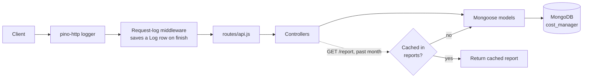

# Cost Manager RESTful Web API

A RESTful backend for tracking personal expenses, built with Node.js, Express 5 and MongoDB (Mongoose). Users record costs by category and get monthly reports grouped by category. Reports for past months are computed once and then served from a cache.

## Overview

**Problem:** keeping track of everyday spending means storing many small expenses and answering one question again and again: "what did I spend this month, and on what?"

**Solution:** a small JSON API that stores users and costs, validates input, and builds monthly reports by category. Backdated costs are rejected, so past months never change and their reports are cached after the first request.

## Features

- **One endpoint for users and costs:** `POST /api/add` creates a user when the body has all user fields (`id`, `first_name`, `last_name`, `birthday`). Otherwise it creates a cost item.
- **Input validation:** five categories (`food`, `education`, `health`, `housing`, `sports`), numeric checks, and an existing-user check.
- **No backdated costs:** a cost dated before today (UTC) is rejected with `past_date_not_allowed`. If no date is sent, today's UTC date is used.
- **Monthly reports:** costs sorted by day and grouped by category. Every category appears, even when empty.
- **Report caching (Computed pattern):** reports for past months are saved to a `reports` collection and reused. The current and future months are always computed live.
- **User totals:** `GET /api/users/:id` returns all-time spending, computed with a MongoDB aggregation.
- **Request logging:** Pino / pino-http to stdout, plus one MongoDB `logs` row per request.
- **Consistent JSON errors:** for example `{ "error": "user_not_found" }`.
- **Automated tests:** `node:test` suite with mocked Mongoose models, so no database is needed.

## Tech Stack

| Layer     | Technology                                |
|-----------|-------------------------------------------|
| Runtime   | Node.js (>= 18)                           |
| Framework | Express 5                                 |
| Database  | MongoDB with Mongoose 8                   |
| Logging   | Pino, pino-http                           |
| Config    | dotenv                                    |
| Testing   | `node:test` (built in); axios for `test.js` |

## Architecture

MVC-style layout without views: `routes/` maps endpoints to `controllers/`, which use Mongoose `models/`. Shared helpers live in `utils/`.



For a past month, the reports controller checks `reports` first; on a miss it computes from `costs` and upserts the result. The current and future months skip the cache.

## API Reference

All endpoints are under `/api` and use JSON. `GET /` returns a plain-text health message.

| Method | Path             | Description                              | Parameters / Body |
|--------|------------------|------------------------------------------|-------------------|
| POST   | `/api/add`       | Add a user **or** a cost item            | **User:** `id`, `first_name`, `last_name`, `birthday` (all required).<br>**Cost:** `description`, `category`, `userid`, `sum` (required); `year`, `month`, `day` (optional) |
| GET    | `/api/report`    | Monthly report for a user                | Query `id`, `year`, `month` (numeric; `month` 1-12) |
| GET    | `/api/users`     | List all users                           | None |
| GET    | `/api/users/:id` | User details with total spending         | Path `id` |
| GET    | `/api/logs`      | Latest 500 request logs, newest first    | `Authorization: Bearer <token>` if `LOGS_ACCESS_TOKEN` is set |
| GET    | `/api/about`     | Project team members                     | None |

### Add a cost

```http
POST /api/add
Content-Type: application/json

{ "userid": 123123, "description": "milk", "category": "food", "sum": 8 }
```

`201 Created` returns the saved cost with `year`, `month`, `day` filled in. Errors: `400 missing_fields`, `400 invalid_number`, `400 invalid_date_numbers`, `400 past_date_not_allowed`, `400 validation_error`, `404 user_not_found`.

### Get a monthly report

```http
GET /api/report?id=123123&year=2025&month=9
```

```json
{
  "userid": 123123,
  "year": 2025,
  "month": 9,
  "costs": [
    { "food": [ { "sum": 8, "description": "milk", "day": 15 } ] },
    { "education": [] },
    { "health": [ { "sum": 20, "description": "vitamins", "day": 15 } ] },
    { "housing": [] },
    { "sports": [] }
  ]
}
```

Errors: `400 missing_or_invalid_query_params`, `400 invalid_month`.

### Get user details

```http
GET /api/users/123123
```

```json
{ "first_name": "mosh", "last_name": "israeli", "id": 123123, "total": 33 }
```

Errors: `404 user_not_found`. Unexpected errors on any endpoint return `500 { "error": "server_error" }`.

## Data Models

Schemas are in `models/`, stored in the `cost_manager` database.

- **User** (`users`): `id` (Number, unique), `first_name`, `last_name`, `birthday` (Date).
- **Cost** (`costs`): `description`, `category` (enum of the five categories), `userid` (indexed), `sum`, `year`, `month` (1-12), `day` (1-31), `createdAt`.
- **Report** (`reports`): cached monthly report: `userid`, `year`, `month`, `costs`, `computedAt`. Unique index on `{ userid, year, month }`.
- **Log** (`logs`): `method`, `path`, `status`, `msg` (`endpoint_access`), `at`.

## Security Notes

- **Generic 500 responses:** unexpected errors are logged on the server (`utils/serverError.js`). The client only gets `{ "error": "server_error" }`, so database and driver messages are never exposed.
- **Optional logs token:** when `LOGS_ACCESS_TOKEN` is set, `GET /api/logs` needs `Authorization: Bearer <token>`. The check uses a constant-time comparison, and a wrong or missing token returns `401 { "error": "unauthorized" }`. When the variable is not set, the endpoint stays public and a warning is logged at startup.
- **No authentication on other endpoints:** anyone who can reach the server can create users and costs and read all data. This is a course backend, not a production service; user authentication would be the next step.
- Mongoose `validation_error` responses still include the validation message in `details`. This message describes the input field, not the internals.

## Getting Started

**Prerequisites:** Node.js 18+, npm, and a MongoDB instance (local or MongoDB Atlas).

```bash
git clone https://github.com/wardkadan1/Cost-Manager-RESTful-Web.git
cd Cost-Manager-RESTful-Web
npm install
cp .env.example .env   # then fill in DB_URL
npm start              # runs node app.js
```

| Variable            | Required | Default | Description |
|---------------------|----------|---------|-------------|
| `DB_URL`            | yes      | none    | MongoDB connection string |
| `PORT`              | no       | `3000`  | HTTP port |
| `LOG_LEVEL`         | no       | `info`  | Pino log level |
| `LOGS_ACCESS_TOKEN` | no       | unset   | If set, protects `GET /api/logs` with a Bearer token |

The API is then available at `http://localhost:3000/api` (try `/api/about`). If the MongoDB connection fails, the process exits.

## Testing

```bash
npm test
```

This runs `test/api.test.js` with Node's built-in `node:test` runner. Mongoose calls are mocked, so no database is needed. The 5 tests cover the logs token (public when unset, 401 on a missing or wrong token, 200 on the correct one), generic 500 bodies that leak no internal message, and `GET /api/about`.

`test.js` in the project root is a separate **manual** script. It uses axios to call a remote deployment (its `baseUrl` is hardcoded) and prints the responses. To use it locally, change `baseUrl` to `http://localhost:3000/api` and run `node test.js`. Most of its steps are commented out.

## Team

From `GET /api/about`:

- Ward Keadan
- Shafir Hafif

## Author

**Ward Keadan**
- GitHub: [@wardkadan1](https://github.com/wardkadan1)
- Portfolio: [wardkeadan.vercel.app](https://wardkeadan.vercel.app)
